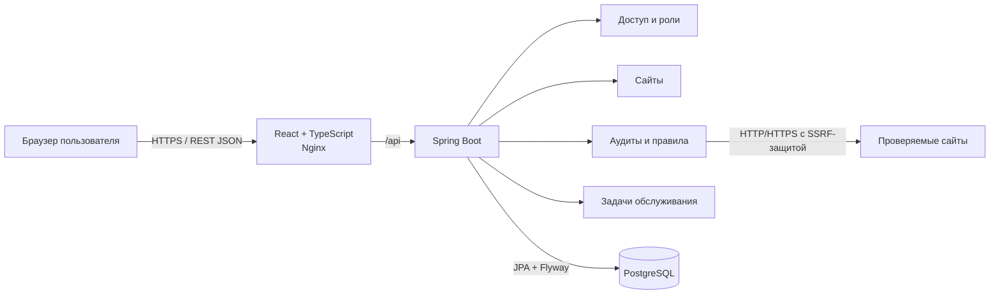
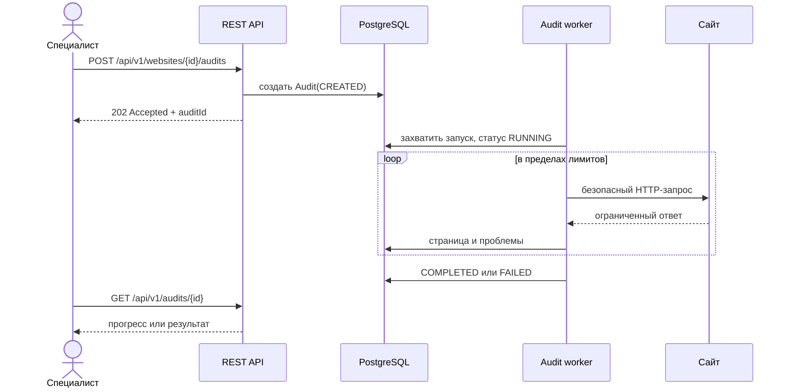

# Архитектура приложения

## 1. Архитектурный стиль

WebCare строится как модульный монолит: один Spring Boot backend содержит изолированные прикладные модули, а аудит выполняется фоновым компонентом внутри того же процесса. Локальный контур состоит из трёх контейнеров; production добавляет Caddy как единственную публичную HTTPS-точку.



## 2. Контейнеры и ответственность

| Контейнер | Ответственность | Порт разработки |
|---|---|---:|
| `frontend` | статические файлы React, fallback маршрутов, reverse proxy `/api` | 3000 |
| `backend` | REST API, права, бизнес-логика, фоновый аудит, health-check | 8080 |
| `postgres` | транзакционные данные и история | 5432 |
| `caddy` | TLS-сертификат и внешний reverse proxy только в production | 80/443 |

В production наружу открыт только Caddy. Он направляет `/api` и `/actuator` напрямую в backend, а остальные запросы — во frontend. Прямые порты frontend, backend и PostgreSQL отсутствуют в `compose.prod.yaml`; публикации из `compose.yaml` оставлены только для локальной разработки и диагностики.

## 3. Модули backend

Основные пакеты текущего MVP внутри `com.webcare.portal`:

```text
api/             общие HTTP-модели, ошибки и health endpoint
auth/            пользователи, роли, вход и проверка доступа
website/         сайты, нормализация URL, политика допустимых адресов
audit/           жизненный цикл, обход, правила и сохранение результатов
maintenance/     задачи обслуживания и история статусов
dashboard/       агрегаты состояния сайтов и рабочей очереди
config/          Spring Security, HTTP-клиент и пул фоновых исполнителей
```

Модули взаимодействуют через сервисные интерфейсы, а не обращаются к репозиториям соседнего модуля напрямую. REST-контроллеры не содержат бизнес-правил.

## 4. Основные потоки

### Ручной аудит



Событие запуска передаётся исполнителю только после фиксации транзакции `CREATED`. Пул из двух потоков обрабатывает аудит без длительной транзакции: каждая страница и обновление прогресса сохраняются короткой отдельной транзакцией. Уникальный частичный индекс не допускает два состояния `CREATED/RUNNING` для одного сайта.

### Сравнение результатов

Каждая проблема получает `fingerprint`, рассчитанный из кода правила и устойчивого контекста элемента. Для сравнения используется составной ключ из нормализованного URL страницы и fingerprint. Ключи двух последних завершённых аудитов сопоставляются множествами:

- есть только в новом — новая проблема;
- есть в обоих — продолжающаяся;
- есть только в предыдущем — исправленная.

### Обслуживание

Одна проблема может быть преобразована не более чем в одну задачу. Задача хранит рабочие поля отдельно от снимка аудита, поэтому её название, приоритет, ответственный и срок можно менять без изменения исходного finding. Каждый переход статуса записывается в `task_status_history` вместе с пользователем, временем и комментарием.

## 5. Границы безопасности

1. Браузер не обращается к проверяемым сайтам — это делает только backend.
2. Компонент URL-политики проверяет схему, хост, порт и результат DNS до открытия соединения.
3. HTTP-клиент не следует редиректам автоматически: каждый `Location` нормализуется и проверяется заново.
4. В ответ загружается не больше настроенного лимита; бинарные типы не анализируются.
5. Обход ограничен нормализованным хостом стартового URL, количеством страниц, глубиной и общим временем.
6. Учётные данные пользователей не передаются проверяемому сайту.

## 6. Авторизация

Spring Security проверяет права на каждом изменяющем endpoint независимо от состояния кнопок интерфейса. SPA использует серверную сессию в `HttpOnly`, `SameSite=Strict` cookie и CSRF-токен для изменяющих запросов. Публичными остаются вход, выдача CSRF-токена и health-check; остальные неизвестные маршруты запрещены по умолчанию.

## 7. Наблюдаемость и ошибки

- `GET /actuator/health` используется контейнерами и системой эксплуатации.
- В журнал пишутся начало и конец аудита, длительность, число страниц, пользователь и смена статуса задач.
- Каждый входящий запрос получает correlation ID.
- API использует единый объект ошибки: код, сообщение, ошибки полей, correlation ID и время.
- Пароли, токены и полное тело проверенных страниц никогда не журналируются.

## 8. Ключевые решения

| Решение | Причина |
|---|---|
| Модульный монолит | соответствует размеру MVP и упрощает транзакции и запуск |
| REST/JSON | прозрачный контракт между React и Spring Boot |
| PostgreSQL | надёжные связи, индексы и транзакции для истории аудитов |
| Flyway | воспроизводимая и проверяемая схема данных |
| Фоновый worker внутри backend | не требует брокера и отдельного сервиса |
| Nginx перед frontend | единый origin для SPA и API, отсутствие CORS в обычном запуске |
| Docker Compose | одинаковое локальное и демонстрационное окружение |
