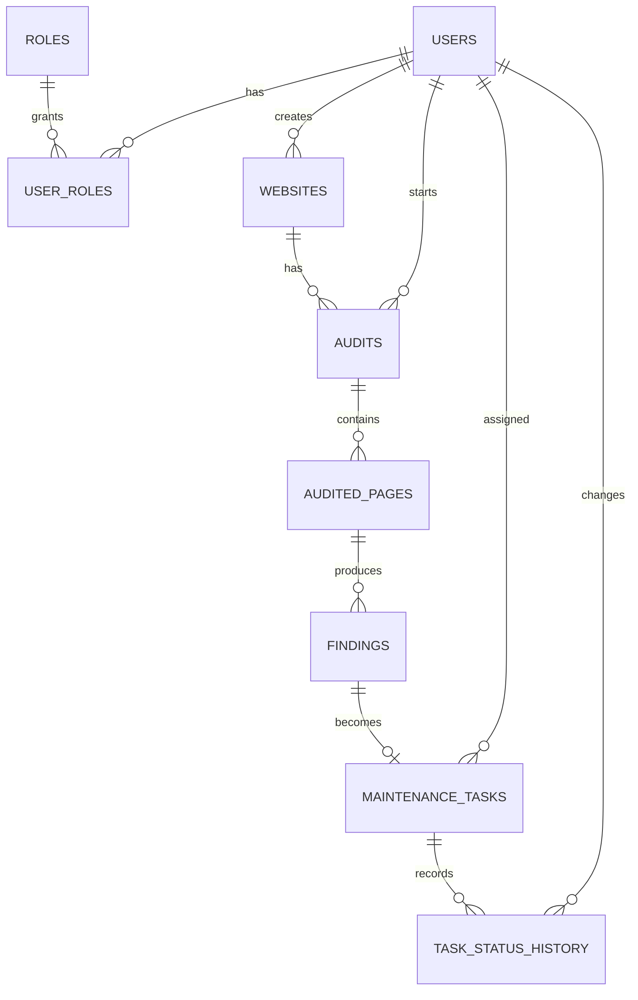

# Модель базы данных

Документ задаёт логическую модель MVP. Физическая схема создаётся миграциями Flyway `V1__create_mvp_schema.sql`, `V2__seed_roles.sql` и `V3__stage_four_indexes.sql`; автоматическое создание схемы через Hibernate запрещено (`ddl-auto=validate`).

## 1. Диаграмма связей

## 2. Таблицы

### `users`

| Поле | Тип | Правило |
|---|---|---|
| `id` | UUID | PK |
| `email` | varchar(254) | уникальный, хранится в нижнем регистре |
| `password_hash` | varchar(255) | не null |
| `display_name` | varchar(120) | не null |
| `active` | boolean | по умолчанию true |
| `created_at`, `updated_at` | timestamptz | UTC, не null |

### `roles` и `user_roles`

`roles`: UUID, уникальный `code` (`ADMIN`, `SPECIALIST`, `VIEWER`), отображаемое имя. `user_roles` содержит составной ключ (`user_id`, `role_id`). В MVP интерфейс назначает одну роль, но модель не ограничивает расширение набора прав.

### `websites`

| Поле | Тип | Правило |
|---|---|---|
| `id` | UUID | PK |
| `name` | varchar(160) | не null |
| `start_url` | text | исходный нормализованный URL |
| `normalized_host` | varchar(253) | уникальный, нижний регистр |
| `max_pages` | integer | 1–100 |
| `max_depth` | integer | 0–3 |
| `active` | boolean | по умолчанию true |
| `created_by_user_id` | UUID | FK → users |
| `created_at`, `updated_at` | timestamptz | UTC |

### `audits`

| Поле | Тип | Правило |
|---|---|---|
| `id` | UUID | PK |
| `website_id` | UUID | FK → websites |
| `started_by_user_id` | UUID | FK → users |
| `status` | varchar(24) | `CREATED`, `RUNNING`, `COMPLETED`, `FAILED` |
| `started_at`, `finished_at` | timestamptz | могут быть null до перехода состояния |
| `pages_discovered`, `pages_checked` | integer | по умолчанию 0 |
| `findings_count` | integer | денормализованный итог |
| `score` | smallint | 0–100 после завершения |
| `failure_code`, `failure_message` | varchar/text | безопасное описание ошибки |
| `created_at` | timestamptz | UTC |

Частичный уникальный индекс запрещает два аудита со статусом `CREATED` или `RUNNING` для одного сайта.

### `audited_pages`

| Поле | Тип | Правило |
|---|---|---|
| `id` | UUID | PK |
| `audit_id` | UUID | FK → audits, каскадное удаление |
| `url`, `normalized_url` | text | исходное и нормализованное значение |
| `depth` | integer | 0–3 |
| `http_status` | integer | null при сетевой ошибке |
| `response_time_ms` | integer | неотрицательное |
| `content_type` | varchar(160) | nullable |
| `response_bytes` | bigint | неотрицательное |
| `checked_at` | timestamptz | UTC |
| `error_code`, `error_message` | varchar/text | без содержимого страницы |

Уникальная пара (`audit_id`, `normalized_url`) удаляет дубликаты внутри запуска.

### `findings`

| Поле | Тип | Правило |
|---|---|---|
| `id` | UUID | PK |
| `audited_page_id` | UUID | FK → audited_pages, каскадное удаление |
| `rule_code` | varchar(64) | стабильный код проверки |
| `severity` | varchar(16) | `CRITICAL`, `HIGH`, `MEDIUM`, `LOW`, `INFO` |
| `title`, `description`, `recommendation` | text | человекочитаемые данные |
| `element_context` | text | короткий безопасный фрагмент, nullable |
| `fingerprint` | char(64) | SHA-256 для сравнения запусков |
| `created_at` | timestamptz | UTC |

Уникальная пара (`audited_page_id`, `fingerprint`) предотвращает повторы правила на одном элементе.

### `maintenance_tasks`

| Поле | Тип | Правило |
|---|---|---|
| `id` | UUID | PK |
| `finding_id` | UUID | FK → findings, уникальный для активной задачи |
| `title`, `description` | text | не null / nullable |
| `priority` | varchar(16) | `LOW`, `MEDIUM`, `HIGH`, `CRITICAL` |
| `status` | varchar(24) | `OPEN`, `IN_PROGRESS`, `DONE`, `CANCELED` |
| `assigned_to_user_id` | UUID | FK → users, nullable |
| `created_by_user_id` | UUID | FK → users |
| `due_at`, `completed_at` | timestamptz | nullable |
| `created_at`, `updated_at` | timestamptz | UTC |

### `task_status_history`

UUID, `task_id`, прежний и новый статус, `changed_by_user_id`, комментарий и `changed_at`. История неизменяема после вставки.

## 3. Индексы

- `users(lower(email))` unique;
- `websites(normalized_host)` unique;
- `audits(website_id, created_at desc)`;
- `audits(status, created_at)` для фонового worker;
- `audited_pages(audit_id, normalized_url)` unique;
- `findings(audited_page_id, severity)`;
- `findings(fingerprint)` для сравнения;
- `maintenance_tasks(status, priority, assigned_to_user_id)`;
- `task_status_history(task_id, changed_at)`.

Миграция V3 добавляет индексы для чтения страниц аудита по глубине, фильтрации findings по правилу и важности и сортировки рабочей очереди по времени обновления.

## 4. Удаление и хранение

- Пользователь и сайт по умолчанию деактивируются, а не удаляются.
- Удаление аудита каскадно удаляет страницы и проблемы; это отдельная административная операция, которой нет в интерфейсе.
- Задача сохраняет связь с проблемой и историей аудита.
- Полный HTML страницы не хранится. Сохраняются только извлечённые показатели и короткий контекст проблемы.
